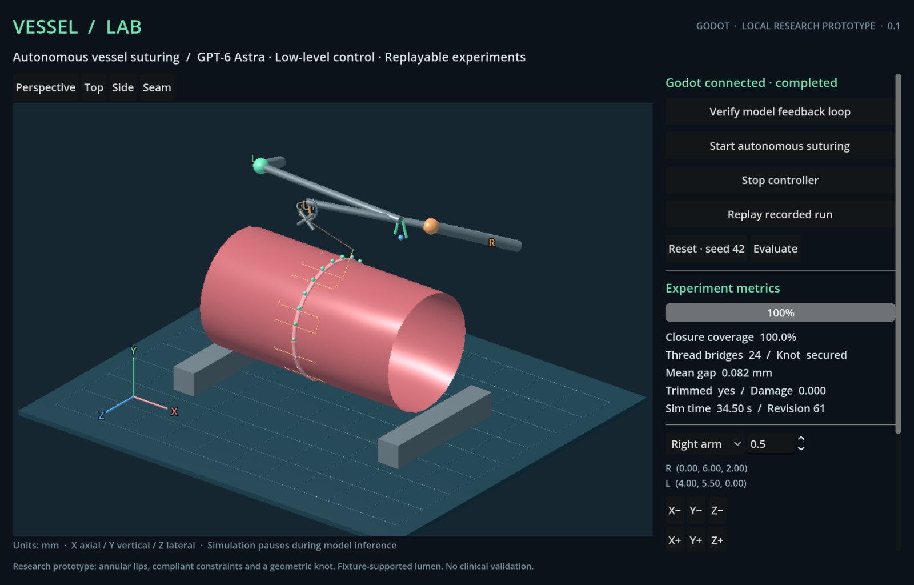

# Vessel Lab

**A Godot-based benchmark for autonomous robotic vessel suturing.**

Vessel Lab connects a language-model controller to a three-dimensional suturing environment through low-level tool calls. Each action produces a rendered Godot observation and instrumented state for the next decision. Episodes are evaluated independently and recorded for deterministic replay.

The project is an experimental embodied-AI research platform. Its simplified mechanics are not clinically validated.



## Capabilities

- Native Godot 3D scene with dual end-effector controls, tissue deformation, puncture events, thread constraints, trimming, and recorded playback.
- GPT-6 Astra controller integration through the Codex app-server protocol.
- Bounded, revision-checked actions with no high-level suturing macro or hidden trajectory planner.
- Explicitly instrumented observations: camera image, tool poses, contact events, tension, and closure measurements.
- Independent terminal evaluation and replayable action/state records.

## Quick start

### Requirements

- Godot 4.
- Node.js 22 or later. No third-party Node packages are required.
- For live controller experiments: a locally authenticated Codex installation with access to `gpt-6-astra`.

```sh
git clone https://github.com/CPTM511/vessel-lab.git
cd vessel-lab
node launch.mjs
```

On macOS, `Start.command` is also available. The launcher locates Godot in standard application locations or on `PATH`; set `GODOT_BIN` for a custom executable. Set `CODEX_BIN` for a custom Codex executable.

To run through the Godot editor, start `node server.mjs`, import `godot/project.godot`, and run the scene. The controller service binds to `127.0.0.1:8765` and is intended for a trusted local, single-user environment.

Validated platform: macOS on Apple M3 Pro, Godot 4.7.2, Node.js 26.5.0, and Codex 0.163.0-alpha.11.2. Other platforms have not been validated.

### Interface

| Control | Behavior |
|---|---|
| Verify model feedback loop | Runs a short live perception/action experiment. |
| Start autonomous suturing | Starts a live controller episode from the current scene. |
| Stop controller | Stops the current controller process. |
| Reset | Starts a new episode with the selected fixture seed. |
| Replay recorded run | Replays recorded commands; falls back to the bundled example when no local recording exists. |
| Evaluate | Ends the episode and runs the independent terminal checks. |
| Manual controls | Select an arm, move along XYZ, grasp, release, or trim. |

Manual actions are locked while a controller episode is active. Recorded playback is labeled separately from live inference. Stop immediately revokes the controller's action lease and terminates its process group; closing the launcher also stops its controller.

### Background execution

Godot explicitly redraws its observation viewport and uploads a heartbeat frame every two seconds. The controller requires a current-session frame less than five seconds old before acting; a missing renderer stops the run. A screen lock does not require the window to remain visible. A sustained macOS lock test recorded 40 changing observations, with physical-console and user-session lock flags true before and after each action. See [runtime verification](evidence/RUNTIME.md).

The host must remain powered on and awake. Screen lock and system sleep are different: execution cannot progress while the host is suspended, and stale observations are rejected after a pause. No operating-system sleep or security settings are changed. Keep the renderer and local service running throughout each experiment.

## Architecture

```text
GPT-6 Astra / Codex app-server
    ↓ observe · step · cut · finish
Local simulation service and constraint solver
    ↓ revisioned scene state
Godot 3D renderer and interaction panel
    ↓ actual camera frame + instrumented observation
Next controller decision
```

The Node service owns simulation state and constraint solving. Godot provides the native renderer and interactive client. Each `step` interpolates only the commanded end-effector motion at 120 Hz; simulation time pauses during model inference. This is an instrumented benchmark, not a vision-only task.

The controller receives no executable reference policy. The trajectories under `tests/` are explicitly scripted mechanics fixtures, and `examples/astra-suture-42.jsonl` is a recording of a live model episode.

## Mechanics and evaluation

The current environment uses two fixture-supported tube segments with 192 particles and compliant distance constraints. A needle-tip sweep through an annular lip produces a puncture; paired punctures create tensile thread constraints. Pulling consumes slack, while unsecured thread slips after release. Knot recognition uses a disclosed geometric winding rule.

`finish` advances the released scene for five simulated seconds and requires all of the following:

1. At least 95% of 24 circumferential samples have a gap no greater than 10% of the vessel radius.
2. The geometric knot is secured.
3. The thread has reached the fixed cutter and been trimmed.
4. Both tools are released.
5. The synthetic damage indicator is below 0.2.

Evaluation is computed by the environment; a controller's success statement cannot override it.

## Experimental result

The vessel-suturing v1 evaluation completed five independent live GPT-6 Astra episodes on the predeclared seeds **1, 7, 42, 99, 2026**. All five passed the unchanged terminal checks. All attempts and rejected commands are retained.

| Seed | Step calls | Godot observations | Rejected tool calls | Coverage | Damage | Maximum gap (mm) | All five checks |
|---|---:|---:|---:|---:|---:|---:|---|
| 1 | 59 | 65 | 0 | 100.00% | 0.000 | 0.081700 | Passed |
| 7 | 60 | 66 | 0 | 100.00% | 0.000 | 0.081802 | Passed |
| 42 | 63 | 133 | 1 | 100.00% | 0.000 | 0.081647 | Passed |
| 99 | 62 | 130 | 1 | 95.83% | 0.030 | 0.553197 | Passed |
| 2026 | 59 | 66 | 0 | 100.00% | 0.000 | 0.081643 | Passed |

These are five observations on a small fixed synthetic fixture set, not a generalization or clinical-validity claim. See the [complete evaluation and reproducible evidence](evidence/EVALUATION.md). The earlier prototype recording remains available in `examples/astra-suture-42.jsonl` and is excluded from this evaluation denominator.

## Reproduction

```sh
npm test
# With the local service and Godot running:
node replay.mjs examples/astra-suture-42.jsonl
# Verify a locally recorded live episode:
node verify-evidence.mjs sessions/<session-id>-agent.jsonl
# Verify a published episode without private session metadata:
node verify-public.mjs evidence/evaluations/attempt-01-seed-1/episode.json
# Run the declared independent live evaluation set (1, 7, 42, 99, 2026):
node evaluate.mjs
```

Local `sessions/` records include accepted/rejected actions, state revisions, controller tool arguments, actual camera frames, and terminal results. The verifier checks image hashes, action correspondence, and deterministic replay. Public examples are sanitized; local authentication data and private session metadata are excluded from the repository.

## Limitations

The current model uses fixed circular support, annular-plane puncture detection, constraint-based thread, and geometric knot recognition. It does not simulate thread self-contact, real knot topology, tissue tearing mechanics, lumen collapse, blood flow, or leakage under pressure. End effectors use kinematic XYZ and jaw controls rather than full robot dynamics or six-degree-of-freedom needle control. The lumen-area measurement is explicitly unavailable (`null`).

These limitations bound the experimental claim. The platform does not establish clinical validity or real-world surgical capability. Other procedures have not been implemented.

## Development

See [CONTRIBUTING.md](CONTRIBUTING.md) for contribution and evidence requirements. Interface references: [Codex app-server](https://learn.chatgpt.com/docs/app-server) and [Godot SubViewport](https://docs.godotengine.org/en/stable/classes/class_subviewport.html).

## License

[MIT](LICENSE).
