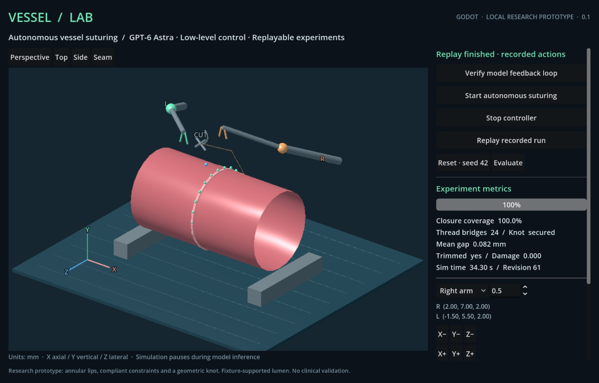

# Prototype verification

Recorded experiment date: October 24, 2026. Mechanics version: 0.1.1.

## Observed results

| Check | Recorded result |
|---|---|
| Controller identity | Codex app-server returned `gpt-6-astra`; model fallback was disabled. |
| Renderer | Godot 4.7.2, OpenGL Compatibility, Apple M3 Pro. |
| Initial feedback-loop experiment | Two autonomous movements and seven Godot image/tool responses. |
| Full suturing episode | 59 `step` calls, one `cut`, one `finish`; 67 image/tool responses in total. |
| Duration | 512.664 seconds for the controller turn; 34.3 simulated seconds. |
| Thread bridges / punctures | 24 / 48. |
| Closure coverage | 24/24 samples, 100%. |
| Maximum gap | 0.0816473 mm. |
| Knot, trim, and release | All passed. |
| Synthetic damage | 0. |
| Independent hold evaluation | Five simulated seconds after release; passed without an external pressure load. |
| Offline verification | All 67 frame hashes matched; model movements corresponded to applied commands; deterministic replay reproduced the result. |
| Restart check | The launcher started the native Godot scene and replay reproduced the passing result. |
| Clean-source check | A Git archive without local sessions replayed the bundled recording successfully. HTTP rejection/idempotency checks passed; see `release-check.json`. |

The live controller turn ran approximately from 00:41:14 to 00:49:47, UTC+08:00. This is a single seed-42 episode and does not establish a general success rate.

## Native interface

The screenshot below shows the English interface replaying the recorded episode. It is a product replay capture, not a newly executed live model experiment. The original model trace and frames are preserved without translation.



## Mechanics checks

`npm test` passed six tests in approximately 54 seconds. Original test output is retained in `sim-tests.txt`.

- Invalid coordinates, non-finite values, stale revisions, and invalid jaw commands leave the state unchanged.
- A needle moving through the empty lumen creates no puncture; slack thread cannot push tissue apart.
- An untreated scene fails evaluation. Unsecured release loses closure. Holding a tool prevents a passing terminal result.
- Scripted reference fixtures pass on seeds 1, 42, and 2026 and reproduce deterministically. These fixtures are engine tests, not model episodes.

## Replay and evidence

The public `examples/astra-suture-42.jsonl` contains sanitized commands from the live episode. It has not been replaced with a scripted fixture. With the service and Godot running:

```sh
node replay.mjs examples/astra-suture-42.jsonl
```

A local live episode can be checked with:

```sh
node verify-evidence.mjs sessions/<session-id>-agent.jsonl
```

The local delivery archive also retains the original `loop/` and `suture/` evidence folders and all tool-response images. Private raw session metadata is excluded from the public repository. These are reproducible local records, not independent third-party attestation.

## Rendering reliability check

The English-interface update uses an explicit Godot redraw for each capture and a bounded upload timeout. `godot/test_background_capture.gd` changed the camera while automatic rendering was disabled and confirmed that a new, nonempty image was uploaded. The actual OpenGL renderer was used; this was not a headless or generated image.

An earlier native-minimization attempt did not confirm the requested OS window state and is retained as a failed verification attempt. The explicit-redraw check is a separate test, not a claim that minimized or locked-host execution has been validated. Both outputs are preserved in `background-capture-check.txt`.

With the local service running and a graphical Godot executable on `PATH`:

```sh
godot --path godot --script res://test_background_capture.gd
```

## Scope limits

The vessel has a supported circular cross-section. Puncture detection uses annular lip planes, thread uses distance constraints, and knot recognition uses accumulated geometric winding. There is no real thread self-contact, full robot dynamics, lumen collapse, blood flow, or pressure/leakage evaluation. The lumen-area measurement returns `null`.

The evidence supports completion of this simplified benchmark. It does not demonstrate clinical validity or real surgical performance. Further procedures and multi-seed live-model evaluation remain outside this recorded result.
