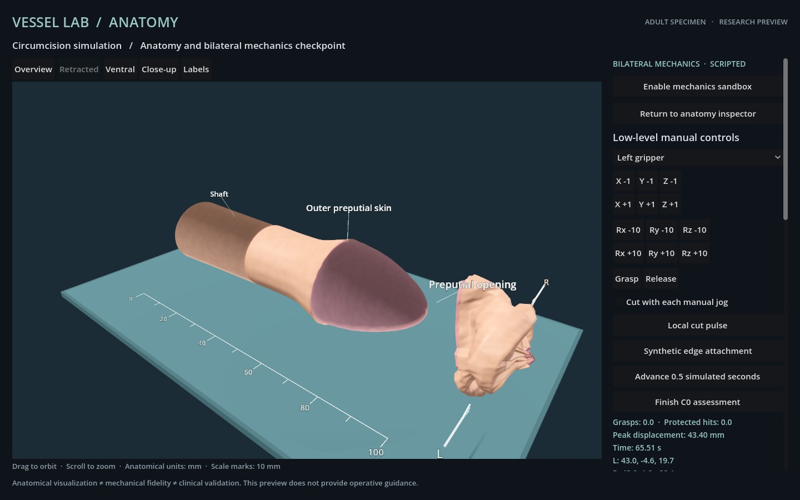
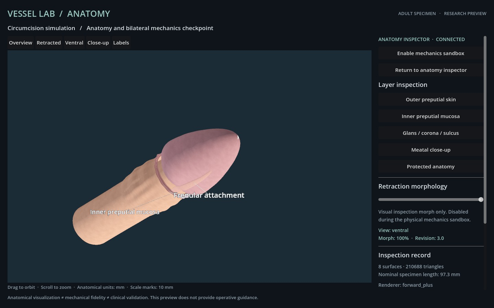

# Anatomy and protected-surface integration

Historical checkpoint: [`3c87412`](https://github.com/CPTM511/vessel-lab/commit/3c87412767d305f5a543e8d25db999f3f5e3888f). Its source and initial conditions differ from S1. Use that revision to reproduce the records below.

This development checkpoint aligns the original visible anatomy with conservative protected-volume queries and couples sampled glans contact with shell separation. It remains a synthetic adult research specimen. Independent model execution and final prototype acceptance are pending.

The complete [actual Godot replay](anatomy-c0-attempt-02/report.json) and [exact offline verification](anatomy-c0-verification.json) pass all unchanged C0 geometric gates. This is scripted engineering evidence on seed 11, not an independent model episode or a completed prototype release.

## Actual rendered trajectory

| Measurement | Result |
| --- | --- |
| Bounded commands / actual Godot frames | 2,023 / 2,023 |
| Renderer | Godot 4.7.2, Forward+ / Metal |
| Maximum command-to-frame latency | 2,490 ms |
| Detached target / removed non-target area | 100% / 0% |
| Protected instrument intersections | 0 |
| Retained edge pairs within 1 mm | 48 / 48; maximum 0.509488 mm |
| Released simulated time | 5.25 seconds |
| Active grasps / attachments | 0 / 0 |
| Invalid retained faces / unresolved target components | 0 / 0 |
| Proper crossings at declared checkpoints | 0 at all 130 checkpoints |
| Contact-limited substeps | 4 |
| Finish | Accepted at mechanical revision 2,024 |

Offline replay reproduces every action and observation, geometry/topology/image hash, all declared crossing audits and Finish. All 16 executed source fingerprints match; all 2,023 image hashes are distinct. The [summary](anatomy-c0-summary.json) records 460 actions with both host-lock flags true before and after: ranges 409–579 and 1,735–2,023. Another 1,560 actions were affirmatively unlocked; three transition/unknown rows remain separate. This is actual locked-host rendering evidence, not a system-sleep claim. It does not replace a final unlocked-background or fallback check.



## Geometry and protection

The frenular attachment is an original thin ventral loft between the glanular underside and retained inner collar. The rounded glans cap has an actual meatal opening and recessed mucosal wall, with shared angular segmentation at the rim. A dedicated close-up supplements the original inspection views. The same primary anatomical reference and original-asset provenance remain documented in [Anatomy and assets](../docs/ANATOMY_AND_ASSETS.md).

The baseline audit exposed visible frenular points outside all protected queries: 450 of 1,105 samples in the covered state, and 617 of 1,105 in full inspection retraction. Fifty and 51 samples, respectively, also lay beyond the 0.5 mm instrument envelope. The largest full-retraction omission was 1.330372 mm. The [baseline witnesses](anatomy-baseline-exclusions.json) are retained; its pure-function extraction preserved the original geometry.

The exporter now derives conservative convex support envelopes from the authored glanular, meatal and frenular vertices, with 0.005 mm padding. The earlier capsule exclusions remain in the union. The [coverage audit](anatomy-protected-coverage.json) queries 128,025 points across three inspection states, with zero named-envelope or union omissions. These envelopes can contain adjacent empty space and provide lower distance bounds, not exact signed distances or clinical injury thresholds.

[Eight actual Godot inspection views](anatomy-inspection-01/report.json) passed with a maximum 861 ms feedback time using Forward+ / Metal. Source and image hashes were checked. The earlier protruding meatal attempt and its source are retained in [the development record](anatomy-development.json).



## Coupled contact and preserved failure

The first full numerical replay with refined anatomy passed the geometric C0 evaluator but exposed 0.1800815723 mm sampled tissue-node penetration into the glans proxy. Shell separation could undo the preceding rigid projection. The protected-instrument counter did not detect that distinct defect.

The revised solver projects sampled rigid support planes and interacting shell planes together, then rechecks both. The 0.1 mm node margin and 0.03 mm shell gap are unchanged. A regression deliberately reproduces the conflicting independent projections and verifies that the joint solve preserves both separations, tangential motion and fixed nodes. The [complete regression suite](anatomy-contact-tests.txt) passes 44 tests.

Replaying the earlier 1,838-action trajectory then produced zero sampled node penetration and zero proper crossings at 126 checkpoints, but [correctly failed specimen clearance](anatomy-scripted-regression-01.json). Its recorded right-side approach missed tissue that had moved under the revised contact response. The other six C0 gates passed. No threshold was weakened.

The [adjusted numerical collection](anatomy-collection-numerical-02.json) refreshes geometric approach points after transit and requires confirmed bilateral grasps. Combined with its verified 1,497-action prefix, the resulting 2,023-action trajectory passes all unchanged numerical C0 gates. The full from-reset actual Godot run above reproduces that adjusted trajectory and its terminal assessment.

Godot's own mechanical surface builder was also queried at revisions [1,188](anatomy-mesh-query-1188.json), [1,497](anatomy-mesh-query-1497.json) and [2,023](anatomy-mesh-query-2023.json). Each exported 36,284 subdivided mesh vertices; none penetrated the sampled glans proxy. This headless geometry diagnostic is not rendered evidence, triangle-interior coverage or continuous rigid-contact verification.

## Remaining limits

The scripted endpoint places zero synthetic attachments. Retained edge approximation is passive authored geometry and recoil, not demonstrated suturing. Final numerical maximum constraint strain is 1.709319. The model has no calibrated living-tissue response, gravity, support-surface collision, remeshed incision, bleeding, healing or clinical outcome validation. The frenulum remains a protected fixture in mechanics. Smooth geometry does not establish mechanical fidelity or clinical validity.

The protocol, target mask and declared independent model seeds remain unchanged. Meaningful seed variation, the final controller, lifecycle and renderer checks, independent episodes and a runnable versioned release remain open gates. The vessel-suturing `v0.1.2` baseline is unaffected.


## Reproduce

Use commit `3c87412` in a separate checkout and confirm its recorded source fingerprints. From that revision's module directory:

```sh
node --test tests/*.test.mjs
node launch.mjs
# With the real Godot renderer running, use a new output directory:
node probe-trajectory.mjs --trajectory evidence/anatomy-c0-attempt-02/trajectory.json --output evidence/local-anatomy-c0
node verify-mechanics.mjs evidence/local-anatomy-c0/report.json
# Verify the bundled record without launching Godot:
node verify-mechanics.mjs evidence/anatomy-c0-attempt-02/report.json
# Regenerate the surface-protection diagnostic:
godot --headless --path godot --script res://audit_anatomy.gd
node audit-anatomy.mjs
```

Only one controller or scripted probe may own the scene at a time. Headless diagnostics are numerical geometry checks and cannot substitute for actual rendered observations. Historical records require their recorded source revision; the previous complete scripted checkpoint is preserved at commit `b3df294`.
