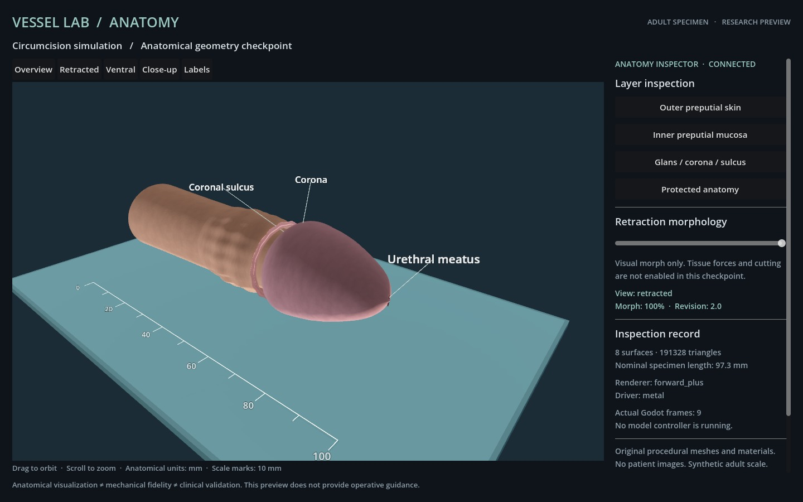
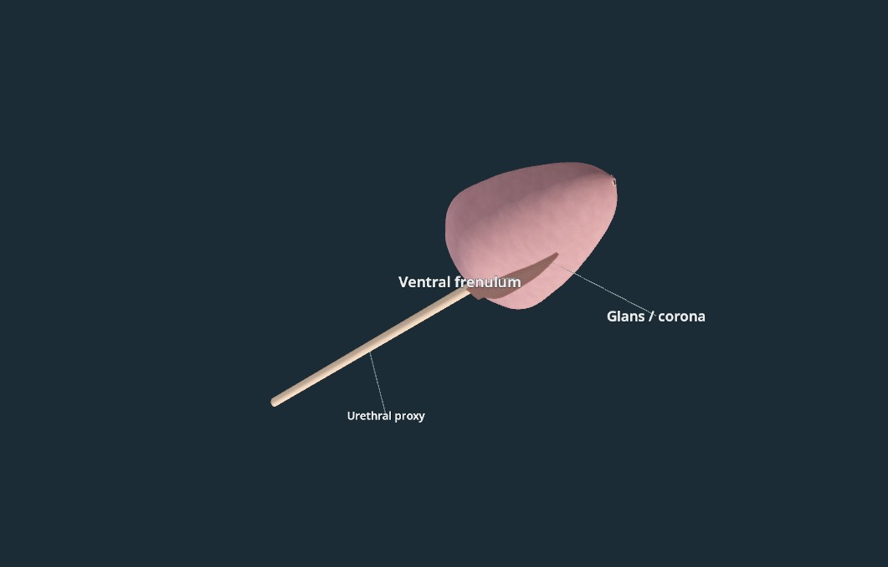

# Anatomy checkpoint: actual rendering and inspectability

This report records the anatomical inspection checkpoint at commit `9390392`. It is retained as historical rendering evidence. Later [bilateral mechanical development](MECHANICS.md) adds physical grasp and deformation; cutting, final scoring and model evaluation remain pending. No live model episodes have run for this module.

The original model contains eight separately organized anatomical surfaces, approximately 191,000 triangles, a double preputial surface with a distal fold, glans/corona, ventral attachment and a urethral proxy. Dimensions are authored synthetic adult-scale values. The inspection UI provides orbit, zoom, millimetre scale and layer selection. Retraction is explicitly a visual morph.

## Recorded checks

| Check | Actual output | Result |
| --- | --- | --- |
| Forward+ / Metal, seven anatomical views | `inspection-attempt-03/` | 7/7 fresh frames; maximum 972 ms |
| Forward+ during actual macOS screen lock | `forward-plus-locked/` | 40/40 changing frames; maximum 1,292 ms; both console and user lock flags true before and after every sample |
| Compatibility / OpenGL fallback, seven views | `compatibility-inspection/` | 7/7 fresh frames; maximum 967 ms |
| Inspection transport regression | `transport-tests.txt` | Atomic validation, stale commands/frames, idempotency and origin checks passed |
| Saved evidence integrity | `checkpoint.json` | 54 image hashes and corresponding checkpoint source hashes verified |

These are **scripted render and transport checks**. They demonstrate real Godot output, not autonomous surgery or clinical performance. The host was already locked; no lock, sleep or security settings were changed. An unlocked-background probe for this new renderer remains pending; screen-lock evidence does not establish execution during system sleep.

The first two visual attempts are retained with review notes. They exposed unreadable labels, ventral occlusion, overlapping shaft skin and a partly embedded frenular web. The third attempt corrects those inspection defects. The meatus and frenulum remain schematic, skin detail remains procedural, and the morph has no validated self-contact or biomechanical behavior. Anatomical expert validation has not occurred.

Forward+ supports the configured subsurface shading. The actual Compatibility images have noticeably different lighting and no subsurface scattering; they are a functional fallback, not evidence of identical visual quality.

The original vessel benchmark remains unchanged at tag `v0.1.2`. Its runtime digest is `5f99a4b67661585ad3b308d1a3322d36f17a14bd2f9003022b2eea46efbcbae8`; no accepted vessel seed was rerun for this checkpoint.
