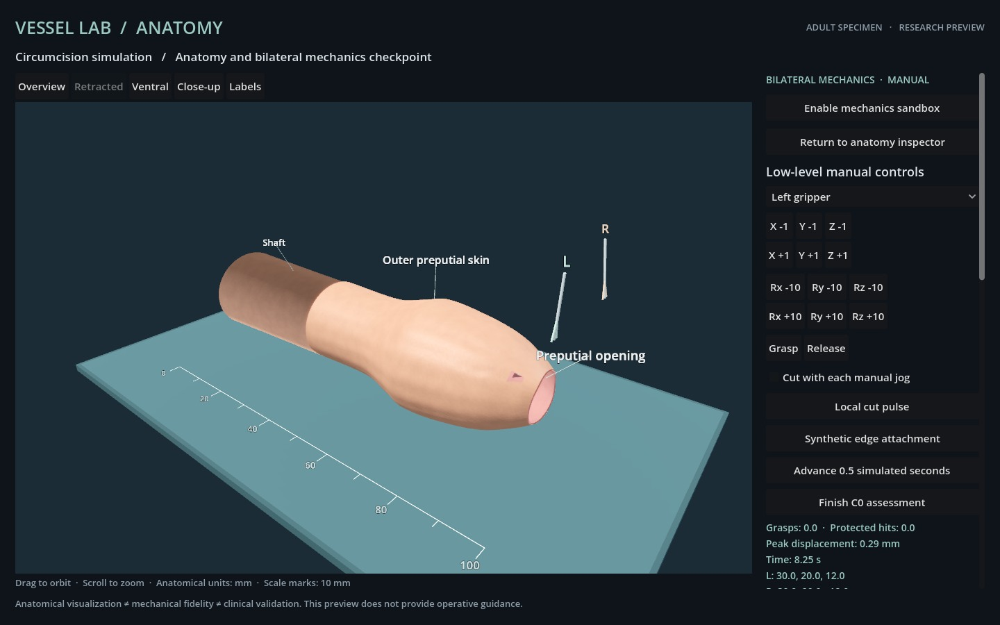

# Synthetic attachment and terminal-assessment evidence

**Scripted development fixture, not an autonomous episode or completed circumcision procedure.** The accepted vessel v0.1.2 source/evidence is unchanged.

## Actual Godot workflow

[The complete record](closure-attempt-01/report.json) contains 72 bounded low-level commands, actual Godot frames, source fingerprints and exact observed state/geometry/topology. After bilateral manipulation and a small local cut, both instruments grasp newly exposed edges, create one explicitly synthetic local attachment, open their jaws, withdraw and advance five simulated seconds.

| Observation | Result |
| --- | ---: |
| Low-level steps with actual Godot images | 72 |
| Maximum command-to-frame latency | 4300 ms |
| Active synthetic attachment after release | 1 |
| Consecutive released simulated time | 5.25 s |
| Total simulated time | 8.25 s |
| Active grasps after release | 0 |
| Protected-volume intersections | 0 |
| Target area removed | 0.130629% |
| Off-target area removed | 0.00% |
| Valid required wound sample pairs | 0 / 48 |
| Recorded invalid retained faces | 0 |
| Complete C0 assessment | **INCOMPLETE** |

The finish request was correctly rejected with `C0 gates unmet: targetDetached, retainedEdgeApproximation`. A local attachment in the distal test opening does not satisfy the required circumferential wound definition. This negative outcome is required for the fixture's verification; it is not relabeled as procedure success.

The screenshot shows the instruments withdrawn and the local opening retained. The synthetic tie has a sub-millimetre span; use the application's close-up view for inspection. The right-hand panel scrolls to the detailed evaluator metrics. The image is actual graphical rendering, not a generated illustration.

Both macOS console/current-user lock flags were true before and after every command. The renderer was Forward+ / Metal. This records operation during the observed locked session, not during system sleep and not a substitute for the full final runtime acceptance on the eventual complete candidate. No host sleep/security settings were changed.

## Verification and controls

- [Offline reproduction](closure-replay-verification.json) exactly reproduces all 72 observations, positions, topology/target labels, attachment states, release timing, frame hashes and the rejected finish.
- [Twenty regressions](closure-tests.txt) pass. New cases cover actual cut-boundary qualification, missing sample denominators, exposed native ties, excessive gaps, collapsed/flipped retained elements, five-second timing, terminal immutability, local attachment creation/invalidation, protected hits and off-target loss.
- [Six corruption checks](closure-negative-verification.json) reject altered actions, image hashes, topology hashes, target hashes, release timing and attachment records.
- [Development regression history](closure-regression-notes.json) retains the initial historical capability-flag assertion failure and its correction. The numerical C0 criteria were not changed.

The positive-control evaluator test prepares cut strips and relocates a specimen **directly in numerical fixture state** before advancing five simulated seconds. It validates gate conjunction and terminal-state rejection. It is not an instrument-driven full resection, not rendered procedure evidence and not model autonomy. The current rendered fixture correctly remains incomplete.

See [the evaluator definition](../docs/EVALUATOR.md) for exact criteria, synthetic attachment semantics and the conservative substep integrity check. Full instrument-driven resection/closure, large-retraction/self-contact validation, final runtime/clean-source checks and three independent exact-model episodes remain required before a C0 release.
