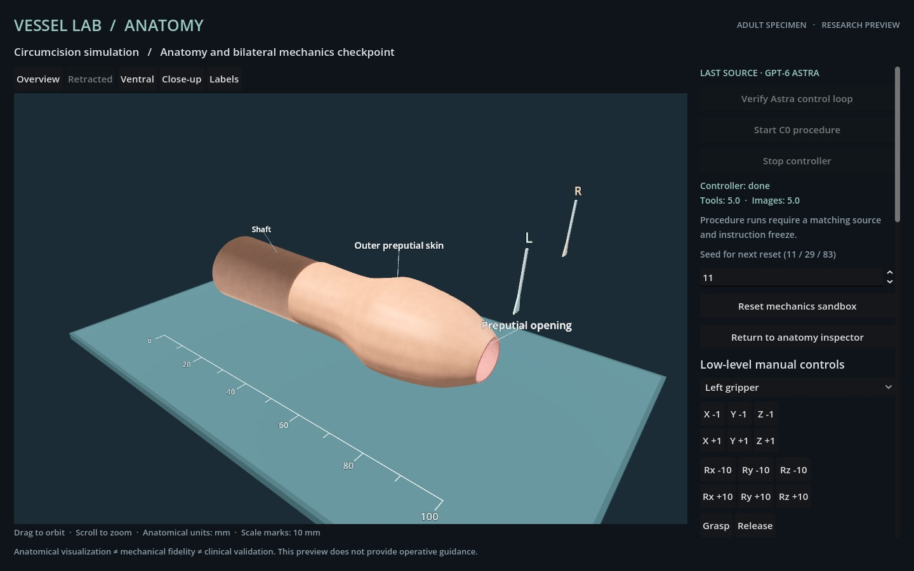

# Actual Astra connectivity checkpoint

This evidence belongs to commit `621436e`; check out that revision for exact full-source verification. Later [recorded-playback checks](PLAYBACK.md) use identical mechanical definitions and do not constitute another live model run.

This checkpoint demonstrates a short actual GPT-6 Astra / Godot feedback loop in the adult anatomy module. It does **not** demonstrate completion of the adult C0 procedure. The independent procedure evaluation set has not started.

| Measure | Recorded result |
| --- | --- |
| Model | `gpt-6-astra`, provider `openai` |
| Reasoning effort | Inherited `xhigh` |
| Scenario | S1 seed 11, scale 0.92 |
| Attempts | 1 connectivity attempt; 0 complete procedure attempts |
| Calls | 3 observations, then 2 sequential step calls |
| Actual image responses | 5 |
| Model-selected movements | Left +0.75 mm Y; right +0.75 mm Y |
| Rejected calls | 0 |
| Maximum command-to-frame time | 1,223 ms |
| Protected contacts / cuts / grasps / attachments | 0 / 0 / 0 / 0 |
| Final mechanical revision | 2; C0 remains incomplete |

Executed runtime digest: `871337d8e4e1de41b83db6864eb37f1aa0d4e39a360ea6b97820cc7c26c0d663`. The journal retains exact model choices, English narration, observations, image hashes and per-file source hashes. Five original JPEGs are copied byte-for-byte. Only access checks and private session identifiers are redacted. No scripted trajectory was supplied to this model run.

Actual Godot Forward+/Metal rendering continued while both macOS console and current-user session lock flags were true before and after all five calls. The two step responses changed the rendered instrument positions. This is a two-action locked-host connectivity result, **not** the final C0 reliability gate of 20 changing background frames and 40 changing locked-host frames. No system-sleep result is claimed.

The offline verifier exactly reproduces both commands, the returned mechanical state, geometry/topology hashes and terminal incompleteness. Six separate corruptions of model identity, action, source digest, observation, frame association and a missing result are rejected. The numerical verifier checks recorded JPEG integrity; it does not reconstruct image pixels. Private access checks are omitted from the public artifact and are reported as unavailable to public verification.

A related scripted local fixture on this exact runtime passed 82 actual grasp/cut/attachment/release actions, maximum 3,550 ms, with affirmative lock flags throughout. Its single synthetic attachment remained after more than five seconds released. The incomplete procedure correctly rejected Finish, and all observations, topology/geometry/image hashes and rejection reproduce offline. These 82 frames are scripted evidence and are excluded from the five model observations. See [the local report](controller-closure-01/report.json) and [verification](controller-closure-verification.json).

The final 57-test suite includes protocol doubles for unavailable access, API authentication rejection, wrong model/provider, a server-request/client-response ID collision, overlapping controllers, locked manual/reset controls, Stop revocation and process-group cleanup, prohibited procedure actions in connectivity mode, missing post-action feedback, and bounded read-only geometry sensors. Test-double images are prerecorded transport fixtures and are not counted in the five actual model observations.

```sh
# From procedures/circumcision at this checkpoint:
node verify-controller.mjs evidence/controller-loop-01
node --test tests/*.test.mjs
```

See [the controller interface](../docs/CONTROLLER.md), [sanitized live journal](controller-loop-01/agent.jsonl), [verification](controller-loop-verification.json), [negative verification checks](controller-verifier-negative.json) and [test output](controller-tests.txt). The full source/instruction freeze, three independent complete procedure episodes, final renderer/lifecycle checks, recorded playback and versioned adult release remain pending.


