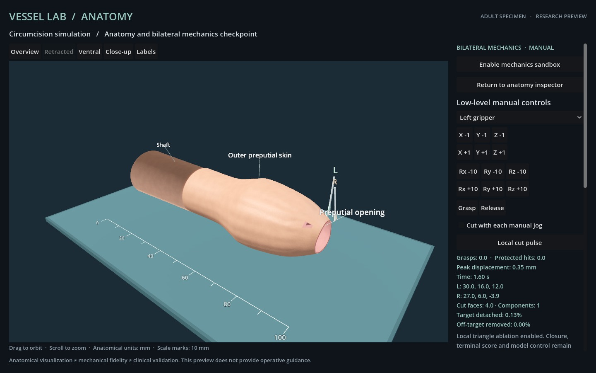

# Local cutting development evidence

**Scripted fixture only. No model inference or completed circumcision episode.** The v0.1.2 vessel-suturing release is unchanged. The complete adult prototype C0 gates remain unmet.

## Actual rendered run

[The complete record](cutting-attempt-01/report.json) contains 29 bounded low-level steps, their observed states, actual Godot images, source fingerprints and mechanical geometry/topology hashes. It first exercises bilateral grasp and release, then approaches a distal surface point, applies a stationary cut pulse and a short swept cut, and withdraws without further cutting.

| Measured result | Value |
| --- | ---: |
| Actual Godot images following actions | 29 |
| Maximum action-to-render latency | 1914 ms |
| Removed local cage triangles | 4 / 4608 |
| Initial material area removed | 6.067605 mm² |
| Target area detached/ablated | 0.130629% |
| Off-target area removed | 0.00% |
| Protected-volume intersections | 0 |
| Final active grasps | 0 |
| Remaining connected components | 1 |
| Simulated duration | 1.60 s |

Both read-only macOS console/current-user lock flags were true before and after all 29 actions. Rendering used Forward+ / Metal. This observation is scoped to this fixture; it is not the final C0 40-frame locked-runtime gate or proof of execution during system sleep. No host power/security setting was changed.

The small opening near the distal rim corresponds to the four removed mechanical triangles. The inner layer remains visible behind it. This run intentionally does not detach the whole target region and cannot meet the 95% C0 area threshold. The two-layer component-split case is a separate numerical topology fixture, not an end-to-end cutting trajectory.

## Reproducibility and negative checks

- [Offline replay](cutting-replay-verification.json) reproduces every observation, vertex-position hash, active-face/component/target-label hash and actual-image hash from the saved actions.
- [Twelve regressions](cutting-tests.txt) pass, covering segment/triangle crossings, local ablation, non-latching cuts, grasp invalidation, two-layer connectivity, unsupported bending constraints, immutable rest-area accounting, pose/jaw controls and transport freshness/topology guards.
- [Four tampering checks](cutting-negative-verification.json) reject modified actions, image hashes, topology hashes and target-definition hashes.
- [Target and cutting definitions](../docs/CUTTING.md) specify the independent synthetic mask, whole-triangle ablation and current limitations. The complete runtime/evaluator/controller has not yet been frozen for live episodes.

All prior manipulation and anatomy records remain preserved with their original source fingerprints. Current verification commands are in the [module README](../README.md). The graphical run was also inspected directly for visible mesh holes, English controls and readable partial metrics. Full retraction, retained-element integrity, synthetic edge attachment, released closure, final runtime acceptance and exact-model episodes remain pending.
