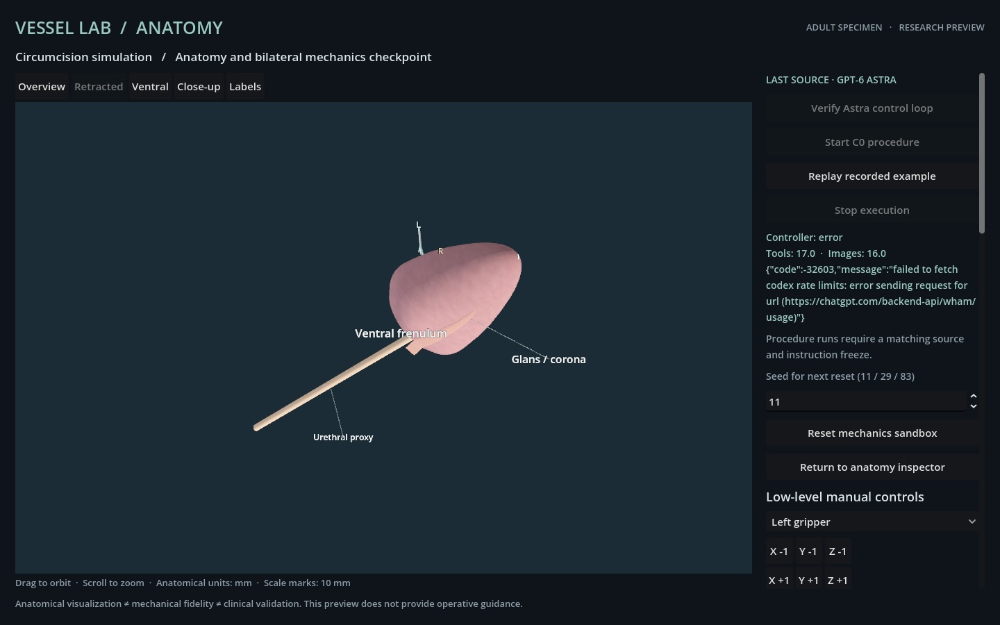

# C0 independent controller evaluation

The first complete-procedure attempt ended without success after an external access-status request failed. **There are zero successful episodes out of one started attempt.** Seeds 29 and 83 have not started. The adult prototype has not met its release gate.

The [source and instruction freeze](../evaluation-freeze.json) was published at `47488cc1ed2a593021d28d5099ae6c16a6b9d119` before evaluation began. Runtime digest: `d5dc3ac1de7d5f322460c8b5aaad7eed6a34a65474cd95c75fd9f59e325acc8b`. The declared seeds remain **11, 29 and 83**; all three complete case successes are required by [protocol C0](../docs/PROTOCOL.md). Every attempt, including infrastructure interruptions, remains in the [evaluation ledger](c0-evaluation-status.json). The historical two-translation connectivity check is excluded from this denominator.

## Seed 11, attempt 01

| Measure | Result |
| --- | --- |
| Actual model / provider | `gpt-6-astra` / `openai` |
| Reasoning effort | Inherited `xhigh` |
| Start / stop | 2026-10-24 09:22:31 / 09:25:05 UTC |
| Model tool requests | 17 |
| Accepted mechanical moves | 9 |
| Actual image responses | 16: 15 successful results and one rejected-action observation |
| Mechanical rejection | One translation exceeding the 4 mm command limit; the model adjusted and continued |
| Last requested action | Not executed; access check failed before simulation access |
| Maximum accepted-command feedback time | 1,739 ms |
| Final mechanical revision | 9 |
| Cuts / protected intersections | 0 / 0 |
| Accepted Finish | None |
| Outcome | Infrastructure interruption; unsuccessful complete-procedure attempt |

The run began from a fresh reset and model context. The frozen controller supplied low-level anatomy tools and actual Godot observations, with no injected trajectory or operator action. The journal preserves the model's original narration, selected camera, geometry queries, all movement requests, the rejected translation and the unexecuted final request.

The terminal error is RPC `-32603`: an external usage-status network request failed. The controller stopped before the next requested operation and exited with an error. This event establishes neither exhausted access allowance nor inability to complete the synthetic procedure. There was no automatic retry in the episode. A later post-stop snapshot matches the final recorded mechanical observation and geometry/topology hashes; it is not a further model observation.

## Reproduction and limits

From `procedures/circumcision` at this evidence revision:

```sh
# Verify the accepted prefix and its real image associations only.
node verify-controller.mjs evidence/c0-seed-11-attempt-01 --aborted-access

# Expected to fail: the record has no successful procedure completion.
node verify-controller.mjs evidence/c0-seed-11-attempt-01

node --test tests/controller-interruption-record.test.mjs
```

The interruption verifier reproduces every accepted mechanical state, geometry/topology query and mechanical rejection, checks actual JPEG hashes and revision associations, and requires exactly one final unresolved request with the recorded access-check error. It returns `recordVerified: true` and **`episodeSucceeded: false`**. The default verifier still requires completed-turn evidence and accepted Finish. [Seven focused tests](c0-interruption-tests.txt) cover the valid partial record, strict completion rejection and five corruptions: unrelated failure cause, fabricated completion, accepted final request, missing earlier result and changed image.

The [public journal](c0-seed-11-attempt-01/agent.jsonl), [16 unchanged JPEGs](c0-seed-11-attempt-01-export.json) and [partial-record verification](c0-seed-11-attempt-01-verification.json) omit private access checks and session identifiers. Recorded private checks preceding the interruption were verified locally. The final access check failed, so a complete post-run access verification is unavailable. Public verification cannot establish redacted private checks. Numerical replay checks recorded image integrity and association; it does not reconstruct pixels or provide clinical validation.

The [preflight record](c0-preflight.json) remains unchanged. Its scripted feasibility and renderer/workflow checks do not count as independent controller successes. Visual realism, mechanical fidelity and clinical validity remain separate, with the previously documented passive approximation, high strain, sampled contact and uncalibrated-material limitations.


