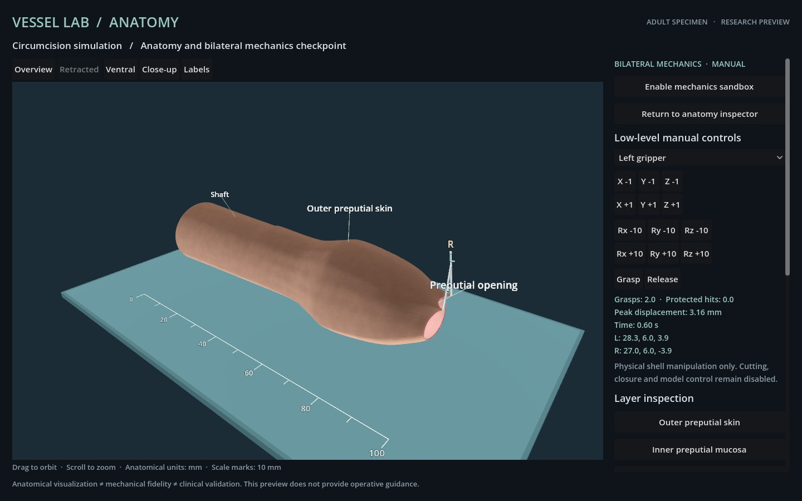

# Bilateral mechanical checkpoint

Status: **manual mechanical development, not a completed procedure**. No model inference was used. The C0 live seed set has not begun.

The final scripted fixture (`mechanics-attempt-03/report.json`) executes 14 low-level commands through the actual local service and Godot renderer. Both instruments approach the tissue, close their jaws, establish separate barycentric grasps, move and release. A rotation command exercises the instrument pose interface. The inspector's visual retraction morph is disabled throughout.

| Measurement | Recorded result |
| --- | --- |
| Simultaneous grasp constraints | 2 |
| Maximum tissue displacement while held | 3.162278 mm |
| Maximum local constraint strain while held | 0.747553 |
| Protected-volume intersections | 0 |
| Active grasps after release | 0 |
| Residual maximum displacement after the fixture | 0.762364 mm |
| Actual rendered action responses | 14 |
| Maximum action-to-frame latency | 1628 ms |
| Console and current-user lock flags before/after every command | Both true |

The fixture advances only 0.85 simulated seconds. It does **not** perform the final protocol's five-second closure hold test. The high peak local strain is reported rather than interpreted as a physiologically accurate response.

All 14 actions, exact observations, geometry hashes and saved JPEG hashes reproduced in offline verification. Deliberately altered action and frame records were rejected. Six targeted regression tests passed: atomic bilateral input validation, bounded orientation, stable rest and fixed boundaries, proximity-based grasp/release, independently queried protected structures, deterministic replay, idempotent transport and missing/malformed/expired frame guards. Transport-only image tests use a labeled prerecorded JPEG fixture and are excluded from the real-frame count.

Earlier scripted development attempts 01 and 02 are retained. They also completed the manipulation fixture, before final transport/launch/UI hardening. The verifier's current-source check intentionally targets attempt 03; older source fingerprints are preserved rather than overwritten.

The original 40-frame locked inspection test belongs to the earlier anatomical checkpoint. These 14 locked mechanical frames add evidence for the heavier deformation path, but do not replace the final candidate's full runtime acceptance suite. The complete C0 task still requires validated retraction/self-contact, local cutting, edge attachment, terminal scoring, actual Astra episodes and clean-source final release checks.



Reproduce the latest evidence with:

```sh
node verify-mechanics.mjs evidence/mechanics-attempt-03/report.json
```

Raw public data: [fixture record](mechanics-attempt-03/report.json), [replay verification](mechanics-replay-verification.json), [corruption checks](mechanics-negative-verification.json), [regression output](mechanics-tests.txt). The solver and its limits are described in [Mechanical model](../docs/MECHANICS.md).
