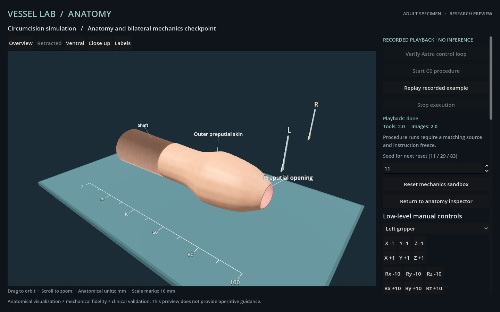

# Recorded playback and renderer checks

This checkpoint adds a labeled recorded-playback workflow to the adult module. It replays the two movements from the historical connectivity experiment, validates the original mechanical record, and obtains new actual Godot frames. It does not call a model. The complete C0 procedure and independent three-seed evaluation remain pending.

Executed runtime digest: `d5dc3ac1de7d5f322460c8b5aaad7eed6a34a65474cd95c75fd9f59e325acc8b`. The original model recording belongs to runtime digest `871337d8e4e1de41b83db6864eb37f1aa0d4e39a360ea6b97820cc7c26c0d663`, commit `621436e`. Mechanical definitions match exactly; controller/UI compatibility does not transfer a live result to changed source.

| Check | Actual frames | Maximum feedback latency | Result |
| --- | ---: | ---: | --- |
| Forward+/Metal recorded playback | 2 | 1,293 ms | Exact replay and new-image association verified |
| Compatibility recorded playback | 2 | 1,112 ms | Exact replay and new-image association verified |
| Forward+ locked inspection changes | 40 | 2,532 ms | All adjacent rendered images changed; both lock flags affirmative throughout |
| Compatibility anatomy inspection | 8 | 967 ms | All declared views rendered and verified |

The four replayed movements have affirmative macOS console/current-user lock flags before and after every operation. All original/new image files are retained. Private session identifiers are removed from the public playback journals; image bytes are unchanged. Inspection changes are scripted visual morphs, not mechanical retraction or autonomous decisions. Neither screen lock nor these tests establish execution during system sleep. The subsequent [S1 preflight](S1_FULL_PATH.md) adds the final current-source unlocked-background check.

Compatibility uses the OpenGL 4.1 path on the tested Apple M3 Pro. It preserves the interactive scene and frame-feedback contract but lacks Forward+ subsurface scattering; highlights and tissue appearance differ. The inspected fallback is functional, not visually equivalent or clinically validated.

The 65-test suite includes replay corruption rejection, mutually exclusive model/playback execution, locked manual/reset controls, Stop, and failure after an accepted command loses its following image. Protocol doubles use a static transport fixture and are excluded from the actual frame counts above. Four additional offline journal mutations—runtime identity, original record hash, frame control-source label and missing rendered result—are rejected.

The subsequent [freeze-isolation checks](freeze-isolation-tests.txt) run missing-freeze tests in temporary copies of the exact runtime. All ten affected checks pass, including a matching synthetic freeze, seven mismatched contract fields and changed runtime source. No freeze is created in the product checkout, and the runtime digest is unchanged. These tests remain valid after a real evaluation freeze is added; they do not authorize an episode or substitute for preflight evidence.

```sh
# From procedures/circumcision at this checkpoint:
node verify-playback.mjs evidence/playback-forward-01
node verify-playback.mjs evidence/playback-compatibility-01
node verify-inspection.mjs evidence/playback-locked-40-01/report.json
node verify-inspection.mjs evidence/playback-compatibility-views-01/report.json
node --test tests/*.test.mjs
```

See [playback behavior](../docs/PLAYBACK.md), [Forward+ verification](playback-forward-verification.json), [Compatibility verification](playback-compatibility-verification.json), [locked inspection verification](playback-locked-verification.json), [fallback inspection verification](playback-views-verification.json), [negative checks](playback-verifier-negative.json) and [regression output](playback-tests.txt). Numerical replay validates recorded geometry and state; JPEG integrity checks do not reconstruct pixels or establish clinical validity.




## Corrected contact runtime refresh

The default two-move example was refreshed under runtime `c0e923ee30e69b394f475258877a47e4c7c96f745413ff17aa667f8a16bab32f` after the rigid projection correction. The new actual GPT-6 Astra / xhigh recording has five images, two accepted moves, zero rejections and620ms maximum feedback. The historical example remains in `controller-loop-original/`; its mechanical hashes intentionally differ. New actual Forward+ playback is preserved in `playback-round6-forward/`, with independent verification in `evaluation-rounds/round6-validation/playback-verification.json`. These connectivity and playback checks are not complete procedure episodes. Historical playback evidence above retains its original source scope.
