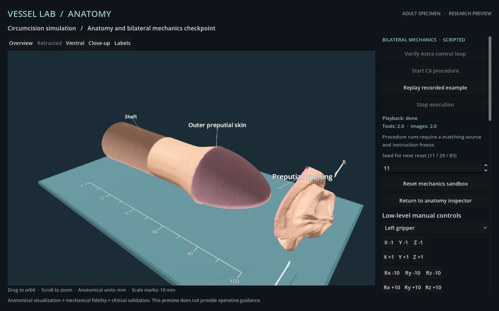

# S1 scripted feasibility and runtime preflight

This checkpoint records engineering verification of the three authored S1 size cases. Numerical replay, actual Godot rendering and model decisions are separate evidence categories. There are **zero independent complete-procedure model episodes** in this record. The historical two-translation Astra connectivity experiment is documented separately.

The executed graphical runtime is commit `2175580`, with source digest `d5dc3ac1de7d5f322460c8b5aaad7eed6a34a65474cd95c75fd9f59e325acc8b`. Subsequent verifier and test changes do not change that runtime. The original vessel-suturing release remains `v0.1.2`.

## Complete scripted path with a preserved interruption

The expanded specimen uses seed 83 and scale 1.08. The from-reset run stopped after 1,453 accepted actions when a manual camera-view request advanced the world revision. The next scripted command was rejected as stale; the [sanitized transport excerpt](s1-camera-interruption.json) preserves the view changes, rejection and first resumed action. Geometry, topology, instruments, metrics and assessment remained unchanged at the interruption.

An explicitly separate scripted continuation verified that complete mechanical state before issuing the remaining commands. The combined record retains the original failed report, every original action/frame, the continuation driver and both source fingerprints. It is a segmented scripted trajectory, not an uninterrupted independent episode. No model selected these actions.

| Measurement | Result |
| --- | --- |
| Bounded mechanical commands / actual command frames | 1,915 / 1,915 |
| Maximum command-to-frame latency | 4,816 ms |
| Target detached / non-target removed | 100% / 0% |
| Protected instrument intersections | 0 |
| Retained edge pairs within 1 mm | 48/48; maximum 0.555054 mm |
| Released simulated time | 5.258333 seconds |
| Active grasps / synthetic attachments | 0 / 0 |
| Invalid retained faces / unresolved target components | 0 / 0 |
| Declared proper-crossing audits | Zero proper crossings at all 80 checkpoints |
| Finish and actual terminal frame | Accepted at revision 1,916; terminal frame in 1,006 ms |

The [combined actual record](s1-full-83/report.json), [original interruption](s1-full-83/interrupted-report.json), [development endpoints](s1-development.json) and [offline verification](s1-full-verification.json) are preserved together. The verifier reproduces every recorded choice, geometry/topology hash, observation, numerical endpoint and Finish. It also checks image integrity, recorded feedback deadlines and the continuation's unchanged prefix. The [summary](s1-full-summary.json) distinguishes 1,417 confirmed locked, 496 confirmed unlocked and 2 transition/unknown action pairs. Four [continuation corruption checks](s1-continuation-negative.json) reject changed ancestry, driver, prefix or feedback deadlines. Verification does not reconstruct pixels or independently authenticate host telemetry.



## Numerical development across the declared cases

| Seed / authored scale | Final scripted actions | Largest retained edge gap | Recorded development endpoints |
| --- | --- | --- | --- |
| 11 / .92 | 2,031 | .470425mm | One successful numerical endpoint |
| 29 / 1.00 | 2,411 | .513666mm | Two failed endpoints, then local recovery |
| 83 / 1.08 | 1,915 | .555054mm | Incomplete detachment, safe diagnostic halt, detachment completion, unresolved collection, resolved collection |

These are three authored size cases and nine recorded development endpoints; the continuations are not independent trials. All final numerical endpoints pass the unchanged C0 gates, but all have **zero attachments**. Retained edge proximity comes from authored geometry and recoil, not demonstrated suturing.

Seed 29's initial collection missed a grasp. Its first recovery still left one detached node2.933237 mm from the protected proxy, below the unchanged 3 mm clearance requirement. A local second recovery resolved that failure. Seed 83's original scaled collection would exceed the workspace; its declared diagnostic path explicitly contracts X beyond 25 mm to a maximum 43 mm, within the unchanged 45 mm bound. Two remaining target faces then required explicit local corrections, followed by a second collection. No workspace, target mask or scoring threshold was relaxed.

The numerical records for [seed 11](s1-numerical/seed-11.json) and [seed 29](s1-numerical/seed-29.json) replay against their exact historical source `9d5d907`. Their [verification](s1-numerical/seed-11-verification.json) [results](s1-numerical/seed-29-verification.json) include preserved failed endpoints and declared crossing checkpoints. Four [corruption checks](s1-numerical/negative-checks.json) reject changed source, missing fingerprints, reordered actions and duplicate checkpoints. Seed 83's five numerical endpoints are independently reproduced as prefixes of the actual rendered trajectory.

## Background, fallback and clean-source workflow

Current-source [unlocked-background evidence](background-final-20/report.json) contains 20 changing actual Forward+ frames, maximum 834 ms. Chrome was foreground before and after every sample; the measured Godot process was in the background. Both console and current-user lock flags were false throughout. The [offline verifier](background-final-verification.json) and four [corruption checks](background-negative-checks.json) validate the recorded fields, images and five-second deadline. An earlier [foreground-precondition rejection](background-preflight-rejected.json) produced zero frames and remains separate.

The same runtime's [playback checkpoint](PLAYBACK.md) records 40 changing confirmed-locked frames, eight Compatibility views and two replayed movements on each renderer. Compatibility is a functional fallback with different material appearance and no Forward+ subsurface scattering. These tests do not establish operation during system sleep.

A clean Git-source archive, without a preexisting Godot cache, passed graphical launch, manual reset/move, playback start/reset exclusion/Stop, complete recorded playback and a final reset. The [six workflow observations](clean-workflow/report.json) retain unchanged image bytes. The [exported playback journal](clean-workflow-playback/playback.jsonl) and [exact verification](clean-workflow-playback-verification.json) cover its two replayed movements. This is manual/scripted workflow testing, with no new inference.

## Reproduce and limits

From the current module directory:

```sh
node verify-mechanics.mjs evidence/s1-full-83/report.json --development evidence/s1-development.json
node verify-background.mjs evidence/background-final-20/report.json
node verify-playback.mjs evidence/clean-workflow-playback
# Numerical cases require a separate checkout of the recorded historical source:
node verify-numerical.mjs evidence/s1-numerical/seed-11.json /path/to/9d5d907/procedures/circumcision /tmp/seed11-verification.json
node verify-numerical.mjs evidence/s1-numerical/seed-29.json /path/to/9d5d907/procedures/circumcision /tmp/seed29-verification.json
```

The final expanded-case maximum constraint strain is 1.740984. Crumpling, sampled contact, whole-triangle cutting, authored passive edge proximity, uncalibrated tissue and the absence of gravity/support collision remain material limitations. Visual detail, mechanical fidelity and clinical validity are distinct. This synthetic benchmark has no clinical validation and is not an operative guide. Independent model evaluation and the final adult prototype release remain pending.
