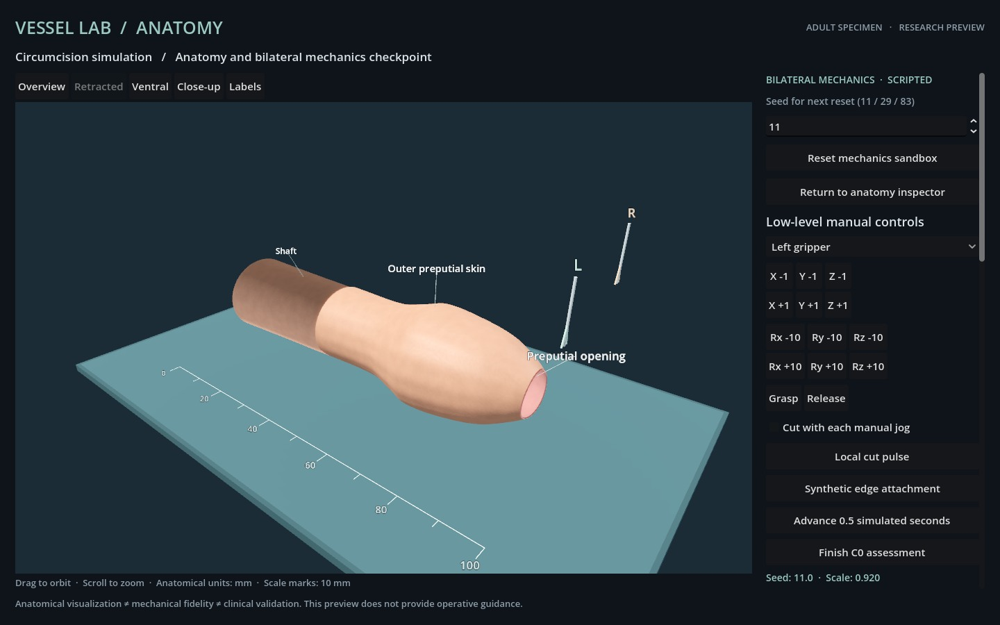
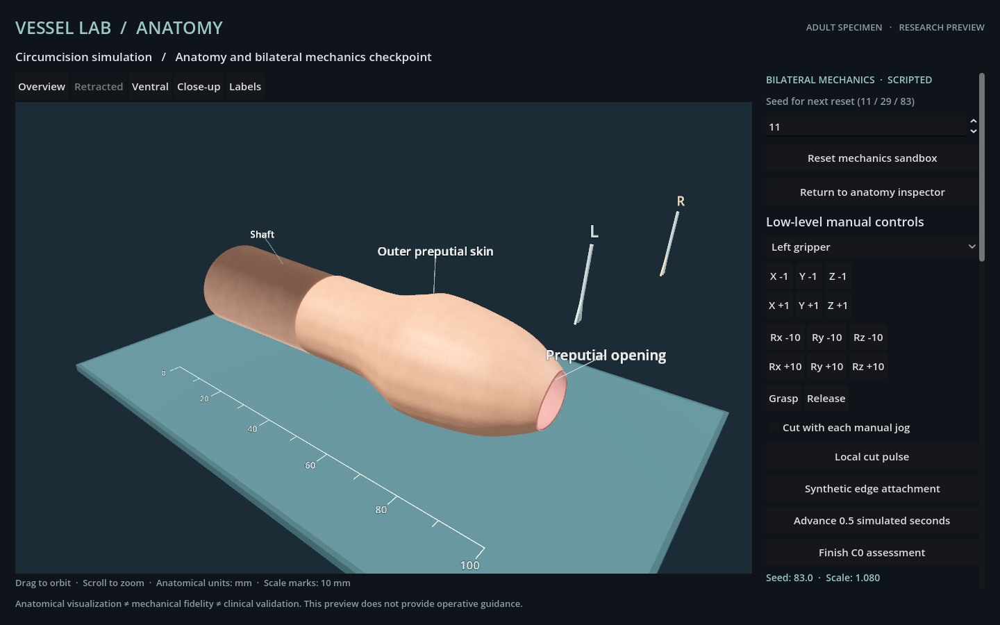

# S1 size-case checkpoint

This checkpoint replaces nearly identical seeded sizes with three explicit authored size cases and reproducible initial instrument offsets. Geometry, target topology and protected volumes scale together; instruments and C0 millimetre thresholds remain unchanged. These are synthetic engineering cases, not samples of patient diversity. See [scenario definitions](../docs/SCENARIOS.md).

## Actual local manipulation and exact replay

Each case starts from reset and uses the same scripted fixture logic: bilateral grasp and displacement, bounded local cuts, one synthetic edge attachment, instrument withdrawal and a released hold. Every accepted action has an actual Godot 4.7.2 Forward+ / Metal image. These are local mechanical checks, not full procedures or live model episodes.

| Seed | Size scale | Actions / actual frames | Maximum feedback latency | Released hold |
| --- | --- | --- | --- | --- |
| 11 | 0.92 | 82 / 82 | 3,522 ms | 5.2583 s |
| 29 | 1.00 | 78 / 78 | 3,653 ms | 5.2500 s |
| 83 | 1.08 | 77 / 77 | 3,608 ms | 5.2417 s |

All three retain one synthetic attachment with zero active grasps, zero recorded protected-instrument intersections and zero non-target area removal. Finish correctly rejects every case because the target-detachment and retained-edge approximation gates remain unmet. A passing local fixture must not be interpreted as a passing C0 endpoint.

The [summary](scenario-summary.json) links the source fingerprints, initial geometry/image hashes and per-case metrics. All three initial geometry hashes and initial image hashes differ. All 237 action images are distinct within their respective episodes. Exact offline verification reproduces every action observation, geometry/topology hash, image hash and expected Finish rejection:

- Seed 11: [actual record](scenario-11-local-01/report.json), [verification](scenario-11-verification-01.json).
- Seed 29: [actual record](scenario-29-local-01/report.json), [verification](scenario-29-verification-01.json).
- Seed 83: [actual record](scenario-83-local-01/report.json), [verification](scenario-83-verification-01.json).

Initial views for all cases and released views for seeds 11 and 83 were visually inspected. The scene displays the seed and scale, a fixed millimetre ruler and English source labels. The seed input explicitly applies to the next reset. Uniform scaling is visible; this does not establish anatomical or material validity.





## Checks and scope

The [47-test regression suite](scenario-tests.txt) passes. It covers deterministic starts, distinct declared sizes, area scaling, unchanged target topology and C0 constants, clear instruments, initial node/glans separation, proper shell-crossing diagnostics and stable rest states. Transport checks reject missing or incorrect frame seed/scale metadata. Separate [record tampering checks](scenario-verifier-negative.json) confirm that the offline verifier rejects altered frame seed and scale values.

The frame reports the actual Godot specimen transform scale, which must match the simulator within `1e-6`. This tolerance accommodates transform precision; it does not change any mechanical or terminal threshold. Metadata checks and image hashes associate records with a scene; they are not independent image-based anatomical measurement.

The complete 2,023-action result remains a historical result at [commit `3c87412`](ANATOMY_INTEGRATION.md). Its old seed formula and initial tool positions differ, so it is not a full-path success for S1. Complete-path behavior across the new sizes, final controller/lifecycle/renderer checks, source and instruction freeze, independent Astra episodes and a versioned adult release remain pending. No clinical validation is claimed.

## Reproduce

Use the matching source revision recorded in each report. From the module directory, start `node launch.mjs`, then run one probe at a time with a fresh output directory:

```sh
node --test tests/*.test.mjs
node probe-mechanics.mjs --closure --seed 11 --output evidence/local-s1-11
node verify-mechanics.mjs evidence/local-s1-11/report.json
# Repeat separately with --seed 29 and --seed 83 and new output directories.
# Verify a bundled record without launching Godot:
node verify-mechanics.mjs evidence/scenario-11-local-01/report.json
```

Only one controller or probe may own the scene. Offline replay is numerical verification; it does not produce new rendered or model evidence. All three actual local attempts passed; no failed local attempt was excluded.
