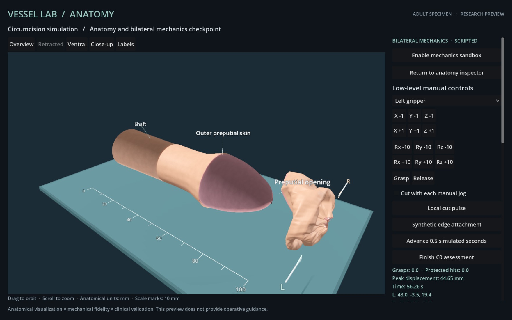

# Complete scripted C0 mechanics checkpoint

Historical source: commit `b3df294`. The subsequent [anatomy and coupled-contact checkpoint](ANATOMY_INTEGRATION.md) has its own source fingerprints and evidence. Reproduce this record with its historical source.

The first complete low-level scripted fixture passes the existing C0 numerical evaluator. It performs local circumferential face ablation, detachment, two-stage specimen collection, instrument withdrawal and a released hold. This is a deterministic engineering fixture on seed 11, **not an independent model episode or a completed prototype release**. The frozen protocol and evaluator thresholds are unchanged.

## Actual rendered evidence

The [unaltered action/frame report](scripted-c0-attempt-01/report.json), [declared trajectory](scripted-c0-attempt-01/trajectory.json) and streaming journal record **1,838 bounded mechanical commands with 1,838 actual Godot images**. Reset and the accepted Finish request are separate from that step count. The viewport and frame metadata explicitly identify scripted control.

| Measurement | Observed result |
| --- | --- |
| Renderer | Godot 4.7.2, Forward+ / Metal |
| Maximum command-to-frame latency | 2,424 ms |
| Detached initial target area | 100% |
| Removed non-target area | 0% |
| Protected instrument intersections | 0 |
| Ablated control faces | 192 |
| Retained wound sample pairs within 1 mm | 48 / 48; maximum 0.509419 mm |
| Released simulated time | 5.241667 s |
| Active grasps / synthetic attachments | 0 / 0 |
| Invalid retained faces / unresolved target components | 0 / 0 |
| Proper triangle crossings at declared checkpoints | 0 at all 126 checkpoints |
| Contact-limited substeps | 0 |
| Finish | Accepted, mechanical revision 1,839 |

[Independent offline replay](scripted-c0-verification.json) reproduces every action, observed state, geometry and topology hash, actual image hash, declared mesh audit and final assessment. All 16 executed source fingerprints match. Historical fixtures must be verified with their recorded source revision.

The host was affirmatively locked before and after all **385 consecutive commands 1,454–1,838**, with both console and current-user flags true and 385 distinct rendered image hashes. Another 1,451 commands have both flags false before and after. Command 385 has an unavailable after-action query; command 1,453 spans the transition to locked. Unknown and transition observations are retained. The locked segment alone does not prove unlocked-background behavior. A subsequent [background-render check](background-render-01/report.json) passes **20 changing actual frames**, maximum **1,008 ms**, with both lock flags false and Codex affirmatively foreground before and after every sample. It alternates inspection views of the finished specimen; the mechanical geometry hash and final assessment remain unchanged. Host state is read through AppKit and IORegistry without changing system settings. Neither check establishes system-sleep execution or general unattended reliability.



## Contact response and regression controls

The previous collection paths stalled at real approaching contacts. Increasing sequential projection alone did not resolve interacting planes. The portable JavaScript solver now accumulates those planes during a proposed substep and resolves their constraints together. Parallel triangles can have several equally close features, so projection constrains all nine supporting vertex pairs along the contact normal instead of choosing an arbitrary single closest feature. A final continuous sweep and conservative motion limiting remain mandatory. The synthetic 0.03 mm shell gap is unchanged.

A moving separating-plane certificate checks the minimum of each vertex-pair projection over the entire linear sweep. Near-gap departing features continue the conservative query; approaching features still generate a contact. These changes have controls for layered stacks, tangential motion, fixed obstacles, rotating separation, interior gap loss and a later approaching feature after an initial departure. See [38 portable mechanics/contact checks](support-contact-tests.txt) and [the transport regression](support-transport-tests.txt), including rejected frame/source mismatches. The source-only test initially lacked its prerecorded transport JPEG; that fixture is now bundled and the affected test passes. No native addon or compiler dependency is required.

[Related numerical development records](support-development.json) preserve the complete portable replay and timing limitation. Its 1,838-command replay matched all three numerical stage endpoints exactly, including nodes and contact caches. One numerical command took 11,696 ms during concurrent first launch of a fresh Godot instance; the cause was not established. A later warm replay of the final 341-command phase had a 1,295 ms maximum. Neither numerical timing is substituted for the actual rendered timing above. Earlier failed collection paths and their different source revisions remain documented in [CONTACT.md](CONTACT.md).

## Interpretation and limits

- **Geometric edge approximation is passive in this fixture.** No synthetic attachments were placed. Newly exposed edges remain close through the authored geometry and elastic recoil. The result does not demonstrate suturing, knot stability or clinical wound closure.
- **Protected-volume scoring concerns instruments.** A separate static tissue-node query at revision 1,497 found one node 0.001015 mm inside the sampled glans proxy and three below the solver's 0.1 mm projection margin after shell projection. The instrument counter is not an exact deformable tissue/glans intersection test.
- **Material behavior is uncalibrated.** The detached specimen is visibly crumpled; final maximum constraint strain is 1.526994. There is no gravity or collision with the displayed support surface, calibrated friction, force response, remeshed incision, bleeding or healing. Smooth rendering does not establish mechanical accuracy.
- **The crossing audit is bounded.** It checks proper non-adjacent triangle crossings at recorded checkpoints, not every coplanar overlap or exact continuous intersection of the entire visible anatomy. Shared-vertex neighbors are excluded from shell contact.
- **Visual and controller gates remain open.** Frenular/meatal geometry, meaningful anatomical seed variation, final lifecycle/background/fallback checks and independent exact-model episodes remain pending. There is no clinical validation.

## Reproduce this checkpoint

Use the source revision containing this report and its matching fingerprints. From the module directory:

```sh
node --test tests/*.test.mjs
node launch.mjs
# In another terminal, with the actual Godot renderer running:
node probe-trajectory.mjs --trajectory evidence/scripted-c0-attempt-01/trajectory.json --output evidence/local-scripted-c0
node verify-mechanics.mjs evidence/local-scripted-c0/report.json
# Verify the bundled record without running Godot:
node verify-mechanics.mjs evidence/scripted-c0-attempt-01/report.json
```

Use a new output directory. The complete rendered fixture takes substantial wall-clock time and must finish before another controller starts. The frozen C0 live set remains seeds 11, 29 and 83; **zero adult model episodes have run**.
